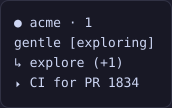
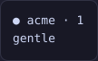
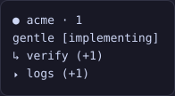
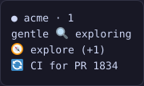
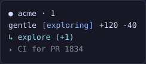
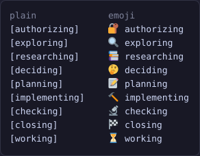

# gentle-herdr-status

Pi extension that shows, in the [Herdr](https://herdr.dev) sidebar, the running subagent,
what the orchestrator is doing and the jobs it launched:

```
● acme · 1
gentle [exploring]
↳ explore (+1)
⏵ CI for PR 1834
```



While the agent is idle only the name row is left:



With the opt-in `$changes` token the row can also show the uncommitted lines of the
session's repo, next to the name:

```
gentle [exploring] +120 -40
↳ explore (+1)
⏵ CI for PR 1834
```

- `$name` is the panel name, `gentle` by default (Herdr rows accept only tokens, never
  literal text); `/herdr-status` renames it. It is published from session start, stays while
  the agent is idle and is cleared on shutdown.
- `$phase` follows the orchestrator: the ODD phase gentle-pi shows in its own prompt
  label, as one plain lowercase word in square brackets (`[exploring]`,
  `[implementing]`, `[checking]`, …), or `[working]` while no phase is reported. It
  disappears when the agent goes idle, so the row reads just `gentle`. With the emoji
  style the same token is an emoji plus the word, without brackets (see
  [Emoji style](#emoji-style)).
- `$subagent` holds the `↳ ` prefix that marks the row as a subagent, the oldest
  running subagent's name without gentle-pi's `gentle-ai-` prefix (`gentle-ai-explore`
  shows as `explore`), plus how many other subagents run alongside it, in parentheses
  with a `+`, when two or more run, e.g. `↳ explore`, `↳ verify (+1)`. Names are sanitized
  to one line of at most 32 characters: terminal escape sequences (CSI colours and OSC
  titles) and control characters are dropped. It disappears when no subagent runs; the
  arrow never shows on its own. The emoji style replaces the arrow with an emoji per
  agent (`🧭 explore`, see [Emoji style](#emoji-style)).
- `$jobs` holds the `⏵ ` prefix and the oldest running job's label, plus how many other
  jobs run alongside it, in parentheses with a `+`, when two or more run, e.g.
  `⏵ CI for PR 1834`, `⏵ logs (+1)`. With the emoji style the prefix is `🔄 `
  (`🔄 CI for PR 1834`). A job keeps
  running without a turn, so this row is published while the agent is idle too; it is
  cleared when no job runs, on session start and on shutdown.
- `$changes` is opt-in: only when it is turned on (in the config file, or with
  `PI_HERDR_STATUS_CHANGES=1`) it holds the lines the session's repo has without
  committing, as `+<added> -<deleted>` (e.g. `+120 -40`, `+5 -0`), so it reads next to the
  name. While it is off nothing is computed, git is never run and the token stays unset.
  See [Configuration](#configuration).

With two subagents and two jobs running, each row carries the oldest one plus how many
others run alongside it:



The package is published as `gentle-herdr-status`. The config directory
(`~/.config/pi-herdr-status/`) and the managed block markers
(`# BEGIN pi-herdr-status …`) keep their original names, so an existing install keeps its
settings and its Herdr block without migrating anything.

## Configuration

Everything is opt-in, so with no file and no variables the sidebar looks exactly as
described above. There are two sources, and the two environment variables that existed
before the file always win over it:

1. the JSON file `$XDG_CONFIG_HOME/pi-herdr-status/config.json` (or
   `~/.config/pi-herdr-status/config.json` when `XDG_CONFIG_HOME` is unset), edited with
   [`/herdr-status`](#herdr-status);
2. `PI_HERDR_STATUS_STYLE` and `PI_HERDR_STATUS_CHANGES`, which force their option (see
   [Precedence](#precedence)).

### The config file

```json
{
  "style": "plain",
  "changes": false,
  "name": "gentle",
  "showSubagent": true,
  "showJobs": true,
  "colors": false
}
```

`style` is the one and only style switch: it applies to the whole sidebar at once, never
per section (there is no `phaseStyle`, `subagentStyle` or `jobsStyle`).

| Token | `plain` (default) | `emoji` |
| --- | --- | --- |
| `$phase` | `[exploring]` | `🔍 exploring` |
| `$subagent` | `↳ explore (+1)` | `🧭 explore (+1)` |
| `$jobs` | `⏵ build (+1)` | `🔄 build (+1)` |

`$name` and `$changes` never change with the style.



| Field | Values | Default | Panel row | What it does |
| --- | --- | --- | --- | --- |
| `style` | `plain`, `emoji` | `plain` | `Style` | The style of `$phase`, `$subagent` and `$jobs` together (see [Emoji style](#emoji-style)). |
| `changes` | `true`, `false` | `false` | `Show changes` | Turns the `$changes` counter on; while it is off git never runs. |
| `name` | text | `gentle` | `Panel name` | The `$name` token. Sanitized to one line and capped at 32 characters; empty or blank reads `gentle`. |
| `showSubagent` | `true`, `false` | `true` | `Show subagents` | `false` keeps `$subagent` unset, so its row disappears. |
| `showJobs` | `true`, `false` | `true` | `Show jobs` | `false` keeps `$jobs` unset, so its row disappears. |
| `colors` | `true`, `false` | `false` | `Sidebar colors` | Colors in the managed Herdr row (see [Sync Herdr rows](#sync-herdr-rows)). |

A file written by an older version (with `phaseStyle` and `subagentStyle`) keeps working:
if there is no valid `style`, `emoji` in either of those fields reads as `style: "emoji"`
and anything else as `plain`. The next save writes only `style`, so the old fields
disappear.

A missing file, an unreadable one, invalid JSON or an invalid field never breaks the
extension: that field falls back to its own default and the rest is kept. Saving writes
the normalized JSON with two spaces and a trailing newline, through a temporary file in
the same directory that is then renamed, so a reader never sees a half-written file, and
creates the directory when it does not exist yet.

`PI_HERDR_STATUS_CONFIG` (a path) replaces the whole file location; the tests use it so
they never touch yours.

### `/herdr-status`

The command opens a panel with one row per option, its current value and, for the options
a variable forces, the mark `(forzado por PI_HERDR_STATUS_STYLE)` or
`(forzado por PI_HERDR_STATUS_CHANGES)`: those rows cannot be changed from the panel. The
rows are `Style`, `Show changes`, `Show subagents`, `Show jobs`, `Sidebar colors` and
`Panel name`, and then the actions `Save changes` and `Sync Herdr rows`.

Every row is explained: the description of the selected row is shown under the list, in
dim text and indented, like `/tokometer`, and it changes as you move. A description says
what the row does and, when the value changes the result, what that value renders, for
example `Style` names `[exploring]`, `↳ explore` and `⏵ build` for `plain` and
`🔍 exploring`, `🧭 explore` and `🔄 build` for `emoji`; `Show changes` says it shows
`+N -M`, the uncommitted lines of the session's repo, next to the name and remeasured on
every Pi event; `Sync Herdr rows` says it writes the Herdr row with a backup and reloads
Herdr. A row forced by a variable says so in its description too (`Fixed by …`), and it is
described with the value in effect, not the one stored in the file.

In the panel a row talks about what you see in the sidebar, never about the metadata token
behind it; the token names (`$changes`, `$subagent`, `$jobs`, `$name`) are documented below
for whoever writes the Herdr row by hand. The option ids and the JSON fields (`changes`,
`showSubagent`, `showJobs`) keep their names, so an existing `config.json` needs no change.

The descriptions live in the config module (`src/config.ts`) next to the labels; the
panel only renders them.

| Key | Action |
| --- | --- |
| `↑` `↓` | Move between rows. |
| `Enter` | Cycle the selected option (`plain` ↔ `emoji`, `on` ↔ `off`), start and confirm editing the panel name, or run the selected action (`Save changes`, `Sync Herdr rows`). |
| `ctrl+s` | Save: write the file and apply it live. |
| `Esc` | Cancel without writing. While editing the name it only leaves the edit, discarding the text. |

Saving writes the JSON and applies it at once: the extension rereads the config and
updates the sidebar at once, so it changes without waiting for the next Pi event, and
turning `changes` on starts the first measurement immediately. It is also the only moment
the extension reads the file besides `session_start`; nothing polls it.

Without an interactive TUI the command writes nothing and only reports the config in
effect and the file path.

The last two rows are actions. `Save changes` writes the JSON and applies it live.
`Sync Herdr rows` saves the same draft and then writes the `pi` row in Herdr's own config,
inside a block this package owns (see [Sync Herdr rows](#sync-herdr-rows)).

### Sync Herdr rows

Herdr rows are Herdr's own configuration, not metadata an extension can publish, so
`Sync Herdr rows` writes the `pi` row into `config.toml` for you. It edits only a block it
owns:

```toml
# BEGIN pi-herdr-status (managed; do not edit)
[ui.sidebar.agents.rows_by_agent]
pi = [["state_icon", "machine", "workspace", "tab"], ["$name", "$phase"], ["$subagent"], ["$jobs"]]
# END pi-herdr-status
```

The rows follow the panel: `$changes` joins the name row only while the counter is on, and
a row whose token is switched off (`$subagent`, `$jobs`) is left out.

Where the file lives, resolved from the environment: `HERDR_CONFIG_PATH` when it is set,
else `$XDG_CONFIG_HOME/herdr/config.toml`, else `~/.config/herdr/config.toml`. The binary
is `HERDR_BIN_PATH` when it is set, else `herdr`.

What it does, in order:

1. Reads the file. **If it does not exist it stops with an error and never creates it**, so
   a wrong path cannot invent a config.
2. Replaces its own block when it is there.
3. Without a block it appends one, unless a `[ui.sidebar.agents.rows_by_agent]` table is
   already there. That table is migrated only when it is exactly the row this package used
   to ask you to write by hand: the comment `# pi-herdr-status:`, the table and a single
   `pi = …` key. Any other `rows_by_agent` table (another tool's, extra keys, a missing
   comment) is refused with a notice and **nothing is written**, so another integration's
   row is never overwritten.
4. Backs the file up to `<config>.pi-herdr-status.bak`, writes a temporary file next to it
   and renames it, so a reader never sees a half-written config. The backup is created only
   when it does not exist yet: it keeps the version from before pi-herdr-status first touched
   the file and a later sync never overwrites it. The temporary file inherits the mode of the
   original before the rename, so a `664` config stays `664` instead of falling to the umask
   (`644`).
   Right before the rename the file is read again: if someone edited it while the sync was
   running, **nothing is written** and the error says the file changed during the sync.
5. Runs `herdr config check`. If it fails, the bytes read at the start of this sync — not the
   backup — are written back and the error reported; the reload never runs. Before restoring,
   the file is read again: if it no longer holds exactly what this sync wrote, someone edited
   it meanwhile, so it is **left alone** and the error names the concurrent edit and the
   backup path.
6. Runs `herdr server reload-config`, so the sidebar picks up the change without
   restarting Herdr.

The result is reported in the panel: synced (info), refused (warning) or failed (error).
The JSON config is saved before the sync, so the block always matches what the panel shows.

With `colors: false` (the default) every cell is a plain token string, which is the block
above. With `colors: true` the cells become Herdr style tables (`{ token = "…", fg = "…",
rules = […] }`), which is where colors live: `fg` takes a strict hex color and `rules`
compare the reported value, first match wins.

| Token | Color |
| --- | --- |
| `$name` | none: the panel name keeps the terminal's default color. |
| `$phase` | one rule per phase, with `contains` and `ignore_case` so both styles match: exploring/researching the `toolTitle` role of the theme, planning/deciding/authorizing `accent`, implementing `warning`, checking `success`, closing `dim`. |
| `$changes` | the `text` role: one color cannot paint `+` green and `-` red inside the same token, so it is not attempted. |
| `$subagent` | the `accent` role. |
| `$jobs` | the `muted` role. |



Those roles come from the Pi/Gentle Shell theme that is active when you run the sync: the
panel reads `ctx.ui.theme.colors`, converts each role to hex and writes it, so the sidebar
follows the same palette as the rest of Pi instead of inventing one. Every `fg` has to be a
strict `#RRGGBB` hex, so a role the theme does not define, or one whose value does not
validate, leaves that cell on the fallback of the built-in Catppuccin Mocha palette (blue
`#89b4fa` for exploring/researching — and for the same group when the theme has no
`toolTitle`, which falls back to `accent` —, mauve `#cba6f7` for
planning/deciding/authorizing, yellow `#f9e2af` for implementing, green `#a6e3a1` for
checking, overlay `#7f849c` for closing and `$jobs`, sky `#89dceb` for `$subagent` and
neutral `#cdd6f4` for `$changes`). A theme that cannot be read at all leaves the whole row
on that palette, so the sync never fails over a theme. The block is a copy, not a live
link: **run Sync Herdr rows again if you change the theme**. Colors are off by default,
like everything else.

To undo it by hand: delete the block from `# BEGIN pi-herdr-status …` through
`# END pi-herdr-status` (or restore `<config>.pi-herdr-status.bak`) and run
`herdr server reload-config`. Nothing else in the file was ever touched.

### Precedence

| Variable | Option | How it is read |
| --- | --- | --- |
| `PI_HERDR_STATUS_STYLE` | `style` | Defined, it forces the whole style: `emoji` only for that exact value, anything else (including `EMOJI` or an empty value) is `plain`. |
| `PI_HERDR_STATUS_CHANGES` | `changes` | Defined, it forces the counter: only the exact value `1` turns it on. |

When one of them is defined, the file never applies to that option, the panel marks the
row as forced and saving keeps the stored value untouched. Options without a variable
always follow the file.

### Emoji style

`style: "emoji"` turns the three tokens to their emoji shape at once, because the icon is
recognized faster than reading the word; `style: "plain"` (the default) is the shape
above. There is no style per section: one switch, the whole sidebar.

```bash
PI_HERDR_STATUS_STYLE=emoji pi
```

The variable forces the same single style and wins over the file. Only the exact value
`emoji` changes anything; unset, empty or any other value (including `EMOJI`) keeps the
plain shape, and the panel marks the row `(forzado por PI_HERDR_STATUS_STYLE)`.

The row then reads `gentle · 🔍 exploring · 🧭 explore · 🔄 build` instead of
`gentle · [exploring] · ↳ explore · ⏵ build`:

| Phase | Emoji | Token |
| --- | --- | --- |
| `authorizing` | 🔐 | `🔐 authorizing` |
| `exploring` | 🔍 | `🔍 exploring` |
| `researching` | 📚 | `📚 researching` |
| `deciding` | 🤔 | `🤔 deciding` |
| `planning` | 📝 | `📝 planning` |
| `implementing` | 🔨 | `🔨 implementing` |
| `checking` | 🔬 | `🔬 checking` |
| `closing` | 🏁 | `🏁 closing` |
| no phase (`working`) | ⏳ | `⏳ working` |

Every emoji is a single codepoint (no `U+FE0F` variation selector), so it is one glyph,
but some fonts render it two columns wide and some one: the row can shift by a cell
between terminals or themes. Nothing else about the phase changes: the word is still
lowercase, untrimmed input is still normalized, the token still clears when the agent
goes idle.

Every phase in both styles, plain on the left and emoji on the right:



### Subagent and jobs emoji style

With `style: "emoji"` the `↳ ` prefix of `$subagent` becomes one emoji per agent, chosen
from the name after dropping gentle-pi's `gentle-ai-` prefix, and the `⏵ ` prefix of
`$jobs` becomes `🔄 `:

| Agent | Emoji | Token |
| --- | --- | --- |
| `explore` | 🧭 | `🧭 explore` |
| `worker` | 🔨 | `🔨 worker` |
| `verify` | 🔎 | `🔎 verify` |
| any other | 🤖 | `🤖 reviewer` |
| a job | 🔄 | `🔄 build` |

Nothing else changes: the counter keeps its parentheses (`🧭 explore (+1)`, `🔄 build
(+1)`), the names are still sanitized and capped at 32 characters, and only the exact
agent name (`explore`, not `explore-x`) has its own emoji. Every emoji is a single
codepoint, with no `U+FE0F`; the jobs prefix is exactly `U+1F504`. With `style: "plain"`
the rows are byte for byte the `↳ explore` and `⏵ build` they always were. `$name` and
`$changes` are not a style: they never change.

### `PI_HERDR_STATUS_DEBUG`

Opt-in diagnostic for `$phase`; see [Debugging](#debugging).

### `PI_HERDR_STATUS_CHANGES`

The exact value `1` forces the `$changes` token on; unset, empty or any other value
(including `0` or `true`) turns it off and never runs git, even if the file says
`"changes": true`. It is off by default because a number that changes all the time is
noise unless you ask for it.

```bash
PI_HERDR_STATUS_CHANGES=1 pi
```

What it counts, always against `HEAD` (`git diff --numstat HEAD`, so staged and unstaged
changes together) plus the lines of the untracked files that git does not ignore
(`git ls-files --others --exclude-standard`). Binary files are skipped. The token is
`+<added> -<deleted>` with an ASCII hyphen and shows a zero part (`+5 -0`); when nothing
changed it disappears. A repo without commits is compared against git's empty tree, and
outside a git repo, with git missing, on error or after a 2 s timeout the token is
cleared instead of keeping the previous value.

When it recalculates, with no timer of its own: on `session_start`, `agent_start`, every
`tool_result` (any tool, so edit/write/bash and the end of a subagent are covered), the
gentle-pi jobs event and `agent_end`. The measurement is asynchronous (`execFile`, no
shell, never blocking events): at most one runs at a time, and events that arrive during
one collapse into exactly one more measurement. It is published in the same report as the
other tokens (same `seq`, source and TTL) and also while the agent is idle, like `$jobs`.

The limit is deliberate: it is event-driven, so changes made outside Pi (another
terminal, an editor, a background job that is not a gentle-pi job) are reflected only on
the next Pi event. Nothing polls the repo.

To show it, add the token to the row with the name:

```toml
pi = [["state_icon", "machine", "workspace", "tab"], ["$name", "$phase", "$changes"], ["$subagent"], ["$jobs"]]
```

![Herdr entry with the uncommitted line counter next to the name: gentle [exploring] +120 -40](docs/screenshots/changes.svg)

## What it does not do

This package only publishes presentation metadata (`pane.report_metadata`). It never:

- reports pane state (working, blocked, idle): Herdr's official Pi integration owns it;
- sends desktop notifications or sounds: Herdr decides them from its `[ui.toast]` and
  `[ui.sound]` settings, so turning them off in Herdr turns them off everywhere;
- reacts to UI prompts: opening a subagent viewer or a menu changes nothing;
- shows branches. Change counts only appear when `$changes` is turned on. Colors are
  optional and only ever written by **Sync Herdr rows**, inside this package's managed
  block in Herdr's own `config.toml`.

## Requirements

- Herdr 0.9.5 or later, with its Pi integration installed in the agent directory Pi uses:

  ```bash
  herdr integration install pi
  herdr integration status   # pi: current
  ```

- Subagents and jobs from [gentle-pi](https://github.com/Gentleman-Programming/gentle-shell)
  (`subagent_run` / `subagent_continue`, and its background jobs). The `$phase` token
  additionally reads gentle-pi's ODD phase registry; without gentle-pi it shows
  `[working]` while the agent runs, and `$jobs` stays empty.

## Install

From GitHub:

```bash
pi install git:github.com/MiguezPablo/gentle-herdr-status
```

From npm, once published:

```bash
pi install npm:gentle-herdr-status
```

Or from a local checkout:

```bash
pi install /absolute/path/to/pi-herdr-status
```

Then add the rows for Pi panes with the panel: run `/herdr-status` inside Pi and choose
**Sync Herdr rows** (see [Sync Herdr rows](#sync-herdr-rows)). It writes the `pi` row
inside a block it owns, so `~/.config/herdr/config.toml` never has to be edited by hand.

Manually, `rows_by_agent` replaces the default rows, so they are listed again:

```toml
[ui.sidebar.agents.rows_by_agent]
pi = [["state_icon", "machine", "workspace", "tab"], ["$name", "$phase"], ["$subagent"], ["$jobs"]]
```

`["$name", "$phase"]` is the `gentle [exploring]` line: the panel name followed by the
phase. With `$changes` turned on, add it to that row (`["$name", "$phase", "$changes"]`)
to read `gentle [exploring] +120 -40`. `$subagent` and `$jobs` live in rows of their own,
so each disappears (row and all) when its token is unset. Apply it with
`herdr server reload-config`. A row whose only token is unset is hidden. If you write it by
hand with the comment `# pi-herdr-status:`, the next **Sync Herdr rows** migrates that row
into the managed block.

## How it works

- Blocking subagents (`mode: "task"`, the default) count from the tool call to its result.
- The name shown drops gentle-pi's `gentle-ai-` prefix (`gentle-ai-worker` -> `worker`); a
  name without that prefix is shown as it comes, and a name that was only the prefix
  falls back to `subagent`.
- Background subagents count from their launch result (`details.gentleAgents`) until
  gentle-pi's `gentle-pi:notification:source` bus reports a finished status
  (`completed`, `failed`, `cancelled`, `timed_out`).
- Only the interactive TUI session publishes; gentle-agents children
  (`GENTLE_PI_AGENTS_CHILD=1`, `--mode rpc`) never do.
- `$name` is the `name` field of the config (`gentle` by default), published from
  `session_start` and kept while the agent is idle so the row keeps its name; it replaces
  the `agent` row item, because Herdr rejects literal text in rows (its error is "custom
  tokens must start with `$`"). It is refreshed with the same TTL and cleared on shutdown.
- Jobs come from gentle-pi's `gentle-ai:jobs-sidebar` event on Pi's event bus
  (`pi.events.on`): `{ sessionId, snapshot: { jobs } }`, where running jobs carry no
  `status` and recently finished ones carry `status`/`endedAt`/`exitCode`. Each event
  replaces the whole state; an event from another session id or with a malformed payload
  changes nothing. Only running jobs are shown, the oldest by `startedAt` first (a tie is
  won by the job that comes first in the snapshot), plus how many others run in
  parentheses (`+N`) when two or more run. The label is sanitized and capped like the
  subagent name (one line, 32 characters, escape sequences and control characters
  dropped), and an empty label falls back to `job`. That event and
  gentle-pi's `JOBS_SIDEBAR_EVENT` name are internals of gentle-pi: they can change
  without notice, and then the row simply disappears.
- The phase comes from gentle-pi's process-global ODD registry
  (`Symbol.for("gentle-pi.odd-phase-registry").get(sessionId)`, `sessionId` from
  `ctx.sessionManager.getSessionId()`). That registry is an internal of gentle-pi: it
  exposes no change event (its single render-request slot belongs to the prompt) and
  gentle-pi clears it when it settles. Polling it every second just for this token was
  not worth it, so the extension reads it only on the events it already handles, turn
  start (`agent_start`), `tool_call` and `tool_result` (gentle-pi's own phase reports are
  tool calls), and clears the token on `agent_end`. A missing registry, a registry
  without `get`, one that throws, or a value outside gentle-pi's phase list all fall
  back to `[working]`; nothing is published while idle. Since that registry is an
  internal, `PI_HERDR_STATUS_DEBUG` logs what each event saw (see [Debugging](#debugging)).
- The style is one configuration switch for the whole sidebar, with the environment
  winning over the file: `phaseToken(value, style)` renders `<emoji> <phase>` instead of
  `[<phase>]`, `SubagentTracker.label(style)` renders the per-agent emoji instead of `↳ `,
  and `JobsTracker.label(style)` renders `🔄 ` instead of `⏵ `. The default (`plain`, and
  the default argument of those three functions) is the previous shape, so no other token
  and no other behaviour changes. An old file with `phaseStyle`/`subagentStyle` is read as
  `plain`/`emoji` and rewritten with only `style` the next time it is saved.
- `$changes` is opt-in too: turning it on (file or `PI_HERDR_STATUS_CHANGES=1`) creates a
  counter that measures the session's `cwd` on the events the extension already handles
  (`session_start`, `agent_start`, every `tool_result`, the jobs event and `agent_end`)
  through an injected git runner (`execFile`, no shell), at most one measurement in flight
  with a single queued re-measurement, a 2 s cap, and `null` on any error. It has no timer
  and no poll of its own; its value travels in the same report and is cleared on
  `session_start` and on shutdown. Turning it off disposes the counter, so git stops
  running at once.
- The config lives in `src/config.ts` (read, normalize, precedence, cycle, rename, atomic
  write, panel rows); the `/herdr-status` panel is a thin TUI layer on top of it and only
  hands the edited config back, so the handler is the one that writes the file and applies
  it.
- The managed Herdr block lives in `src/herdr-config.ts` (rows and colors, the plan for
  replacing or migrating, backup plus atomic write, `herdr config check` and
  `herdr server reload-config`), with the filesystem and the runner injected, so tests only
  ever write temp files and never run the real `herdr`.
- All tokens share source `pi-herdr-status` and one `seq` stream (Herdr orders reports
  per source by `seq`), and every report carries all of them.
- Every token carries a 90 s TTL and is refreshed every 30 s while shown, so they expire
  even if Pi dies. `$jobs` uses the same TTL and refresh; it has no poll of its own, and
  `$phase` is still read only on Pi events. Everything is cleared on session start and
  shutdown.
- Source `pi-herdr-status`, agent `pi`.

## Debugging

If the sidebar shows a phase it should not, point `PI_HERDR_STATUS_DEBUG` at a file
before starting Pi:

```bash
PI_HERDR_STATUS_DEBUG=/tmp/pi-herdr-status.jsonl pi
```

Every event that publishes the tokens (`session_start`, `agent_start`, `agent_end`,
`tool_call`, `tool_result`) then appends one JSON line with the event name and tool name,
the session id that event's `ctx` reported, the id the phase lookup actually used, the
`typeof` of the ODD registry this process sees, the sessions that registry tracks (with
their phase and source), the raw phase read and the token published. That tells apart a
session-id mismatch, a registry loaded by another module instance, and a phase that was
never reported.

The variable is unset by default and then nothing is written. Write failures are ignored,
so the diagnostic never affects the sidebar.
## Development

```bash
npm install
npm test
npm run typecheck
```

The images in this README are generated, not captured: `npm run screenshots` rewrites
`docs/screenshots/` from the same functions that publish the tokens, and `npm test` fails
when a committed SVG is stale. Emoji graphics are
[Twemoji](https://github.com/jdecked/twemoji) by Twitter, Inc and other contributors,
licensed [CC-BY 4.0](https://creativecommons.org/licenses/by/4.0/); the vendored files
live in `scripts/twemoji/`.

## License

MIT
